# 🐉 5eTools Builder

A D&D 5e character builder and playable character sheet that runs in your
browser. It reads the 5eTools data you give it, so it works with any book or
homebrew you have in 5eTools format.

- **Browse** classes, spells, items, species and creatures as clean cards and statblocks.
- **Build** characters step by step, D&D Beyond style, for 2014 or 2024 rules, multiclassing included.
- **Play** from a full character sheet: click to roll, track HP, spell slots, rests and inventory.
- **Import** finished characters from D&D Beyond (link, JSON or PDF).
- **Keep it private**: everything is stored in your browser. There is no account and no server.

> **No official content is included.** The app is an importer: you bring your
> own 5eTools `data/` folder or homebrew files. A small, made-up sample is
> bundled so you can try it out straight away.

## Contents

- [Install](#install)
- [Your first character](#your-first-character)
- [Getting content in](#getting-content-in)
- [Building a character](#building-a-character)
- [Playing from the sheet](#playing-from-the-sheet)
- [Importing from D&D Beyond](#importing-from-dd-beyond)
- [Where your data lives (and backups)](#where-your-data-lives-and-backups)
- [Troubleshooting](#troubleshooting)
- [Known limitations](#known-limitations)
- [For developers](#for-developers)
- [Under the hood: how D&D Beyond builds a sheet](#under-the-hood-how-dd-beyond-builds-a-sheet)

## Install

### What you need

- **Node.js** 22.12 or newer (the current LTS release is fine), from
  [nodejs.org](https://nodejs.org/). It comes with `npm`. Check your version
  with `node --version`.
- **Git**, to download and update the code. Or use **Code → Download ZIP** on
  GitHub instead.
- **A browser**: any current Chrome, Edge, Firefox or Safari.
- **5eTools data** *(optional)*: your own copy of a 5eTools `data/` folder, for
  real classes, spells and items. Without it you can still try the sample.

### Steps

Open a terminal (on Windows: PowerShell) and run:

```bash
# 1. Download the code
git clone https://github.com/NeviSenpai111/DnD-Teil.git
cd DnD-Teil

# 2. Install what the app needs (once, and again after each update)
npm install

# 3. Start the app
npm run dev
```

Then open **http://localhost:5173** in your browser. Leave the terminal open
while you use the app. Press **Ctrl + C** in the terminal to stop it.

### Updating

```bash
cd DnD-Teil
git pull
npm install
npm run dev
```

Your characters and imported content stay where they are; updating the code
doesn't touch them.

### Optional: run the production build

`npm run dev` is fine for everyday use. If you'd like the faster, optimised
version, which is the same build you would put on a web host:

```bash
npm run build
npm run preview    # then open http://localhost:4173
```

The build may warn that some chunks are larger than 500 kB. That's expected
and harmless.

> **Note:** the browser keeps a separate library for each address.
> `localhost:5173` and `localhost:4173` don't share characters. Pick one, or move
> characters between them with **Export** and **Import file…**
> (see [backups](#where-your-data-lives-and-backups)).

## Your first character

1. **Load some content.** In the left-hand **Import content** panel, click
   **Sample** for the bundled test content, or **Import folder…** and pick your
   5eTools `data/` folder. On a narrow window the panel is behind the **☰**
   button at the top left.
2. **Pick the rules.** Use **Edition** in the top bar: *Classic (2014)* or *One (2024)*.
3. **Build.** Open the **Build** tab and work through the numbered pages:
   **Class → Background → Race → Abilities → Equipment** (in 2024 rules, *Race*
   is called *Species*). The top bar shows Level, HP and AC as you go.
4. **Check What's Next.** It lists any choices you haven't made yet.
5. **Save.** Click **Save** in the builder bar. The character now appears under **Characters**.
6. **Play.** In **Characters**, click **View** to open the full sheet.

## Getting content in

All three buttons are in the **Import content** panel:

| Button | Use it for |
|---|---|
| **Import folder…** | **Recommended.** Pick a whole 5eTools `data/` folder; every `.json` file inside is read. Takes a few seconds. |
| **Import JSON…** | Single files, such as a homebrew file or one book's spells. You can select several at once. |
| **Sample** | The bundled sample: a few original classes, species and items, plus the *Space Galleon* vehicle. |

After an import, a short report shows how much came in and any warnings.
Content is saved in the browser, so you only import once, not every visit.

If you import files one by one instead of the whole folder, the builder needs
these for full results:

| For | Import |
|---|---|
| Classes and subclasses | `class/class-*.json` |
| Spells, and which class gets which | `spells/spells-*.json` **and** `spells/sources.json` |
| Species, backgrounds, feats | `races.json`, `backgrounds.json`, `feats.json` |
| Items and equipment | `items-base.json`, `items.json`, `magicvariants.json` |
| Fighting styles, invocations, metamagic, infusions | `optionalfeatures.json` |
| Monsters built from templates | `bestiary/template.json` |

**Sources:** the **Sources** panel lists every book you've imported. Untick a
book to hide its content everywhere. When a newer printing is loaded (for
example the 2024 Fighter), the older one is hidden like on 5eTools; tick
**Show reprinted** to see both.

## Building a character

The builder has one page per step. Use the tabs or the arrows to move around;
you can go back and change anything later.

| Page | What you do there |
|---|---|
| **Home** | Choose the rules edition. 2014: ability bonuses come from your race. 2024: they come from your background. |
| **1. Class** | Set your level, choose skills, subclass, Ability Score Improvements or feats, fighting styles and other class options, and spells (on the **Spells** sub-tab). **+ Add Another Class** multiclasses, with prerequisites checked. |
| **2. Background** | Pick a background (or make a custom one), its skills, tools, languages and feat, and fill in personality, alignment, appearance and notes. |
| **3. Species** (*Race* in 2014) | Pick a species or race and subrace, plus any language, skill or spell choices it grants. |
| **4. Abilities** | Point buy, standard array, rolled or manual scores. Every bonus is itemised, and you can set or override any score by hand. |
| **5. Equipment** | Add starting equipment, search for items, manage coins and see your weight against carrying capacity. |
| **What's Next** | A checklist of open choices, plus Save, Sheet and Export. |

The builder only lets you take what you're entitled to: spell counts, skill
choices, point-buy budget and feat prerequisites are all enforced.

## Playing from the sheet

Open a saved character with **Characters → View**, or click **Sheet** in the
builder bar. The sheet follows D&D Beyond's layout, and it is meant to be played from:

- **Roll anything** by clicking it: skills, saves, ability checks, attacks and damage.
  Results pop up as a dice toast. The **Adv / Dis** toggle at the top applies to every d20.
- **Hit points:** use **Heal** and **Damage** with an amount. Temporary HP is used up
  first. Click the HP box for short and long rests, hit dice and death saves.
- **Spell slots and class resources** (Rage, Ki, Superiority Dice, …) are pips you click to spend.
  Rests restore them.
- **Add spells and items** straight from the sheet with **+ Add Spell** and **+ Add Item**.
  The spell search only offers what your class can cast.
- **Inventory:** equip, attune (up to 3) and drag items into containers. Carried weight and
  encumbrance update automatically.
- **Conditions, inspiration and effects** such as Mage Armor can be switched on and off.
- **Level Up** raises a class level. New choices are then made in the builder.
- **Print** prints just the sheet. **Export JSON** saves a copy of the character.

Changes on a saved character's sheet are saved immediately.

For the full feature list, see [docs/FEATURES.md](docs/FEATURES.md).

## Importing from D&D Beyond

Go to **Characters**. The **Import** panel on the right offers three ways in:

| From | How | Notes |
|---|---|---|
| **A sheet link** | Paste `https://www.dndbeyond.com/characters/<id>` and click **Import**. | The character's privacy must be **Public**. This only works while the app runs with `npm run dev` or `npm run preview`. |
| **The character JSON** | Open `https://character-service.dndbeyond.com/character/v5/character/<id>` in your browser, save the page as a `.json` file, then use **Import file…** | Also needs the character to be **Public**. Works everywhere, including a static web host, and gives the same result as the link. |
| **A PDF export** | On D&D Beyond, use **Export → PDF**, then **Import file…** | Less exact than the link or JSON, but works for characters you can't make public. |

Before you import, **import your 5eTools content first.** The importer looks up
the character's class, species, spells and items by name in your library.
Without content, the numbers still come over, but the class, spells and items
don't.

After the import, a short report lists anything that couldn't be matched. The
app reports these instead of guessing. Open the character in the builder and
check **What's Next**: feats in particular may need a second look.

## Where your data lives (and backups)

- **Everything stays on your computer**, in your browser's storage (IndexedDB).
  Nothing is uploaded, and there is no account.
- Each browser, browser profile and address (`localhost:5173`, `localhost:4173`, a
  web host) has **its own separate library**.
- **Clearing your browser's site data deletes your characters and imported content.**
- **Back up** a character with **Export** (in Characters) or **Export JSON** (on the sheet).
  Restore it, or move it to another computer, with **Characters → Import file…**
- The character you're building is saved automatically as a draft. **Save** adds
  it to your library.

## Troubleshooting

| Problem | What to do |
|---|---|
| `npm: command not found` / `'npm' is not recognized` | Install Node.js from [nodejs.org](https://nodejs.org/), then open a **new** terminal. |
| Vite says your Node.js version is too old | Install the current LTS release of Node.js (22.12 or newer). |
| The page won't load | Is the terminal running `npm run dev` still open? If port 5173 was busy, the terminal shows the address it used instead. |
| Builder lists are empty | Import content first: click **Sample** or **Import folder…** |
| A class gets no spells, or every spell | Import `spells/sources.json` (or use **Import folder…**). The builder warns when it's missing. |
| No fighting styles, invocations or metamagic to pick | Import `optionalfeatures.json`. 5eTools keeps them out of the class files. |
| My characters disappeared | Check the address: `localhost:5173` and `localhost:4173` keep separate libraries. Also check you're in the same browser and profile. |
| D&D Beyond link import fails | Set the character to **Public** on D&D Beyond. On a static web host the link can't work; use the JSON file route instead. |
| A homebrew image doesn't show | In the built app (`npm run preview` or a web host), images must be served over `https://`. Plain `http://` images are blocked. |
| Something looks broken after `git pull` | Run `npm install` again, then restart `npm run dev`. |

## Known limitations

- **Feats:** free-choice tool and language grants, and saving-throw choices (Resilient), are
  shown but can't be picked yet.
- **Multiclassing:** saving throws and starting proficiencies come from the first class only.
  Feat spells don't use the chosen ability for their DC.
- **Starting equipment** takes the first option of each choice; alternatives and the gold
  option are simplified.
- **Rests:** a long rest restores *all* hit dice, resources and item charges (the rules restore
  half the dice). Which resources a short rest restores is a best guess by name.
- **Prerequisites:** ability scores and level are checked; race, spellcasting and proficiency
  prerequisites are shown but not enforced. Container capacity is shown but not enforced.
- **Links:** cross-references in text are styled, but you can't click through to them yet.

## For developers

```bash
npm run dev            # dev server with hot reload (http://localhost:5173)
npm test               # unit and acceptance tests (Vitest)
npm run typecheck      # types only
npm run build          # typecheck + production build into dist/
npm run preview        # serve dist/ (http://localhost:4173)
npm run validate-data  # import a real 5eTools data/ folder and report
```

It is a client-only React 19 + TypeScript app built with Vite. Zustand holds
state and Dexie stores it in IndexedDB. A character stores only the player's
**choices**; every number on the sheet is recomputed from them and the
imported content.

[docs/DEVELOPMENT.md](docs/DEVELOPMENT.md) covers the code layout, how the
5eTools import works, how D&D Beyond characters are mapped, and how to test
against real data.

## Under the hood: how D&D Beyond builds a sheet

To import D&D Beyond characters faithfully, we studied how D&D Beyond's own
sheet works. We captured a public character loading in the browser and read
the published character-app code (version 1.72.9, October 2026). These diagrams
describe **D&D Beyond's** sheet, not this app.

The main finding: D&D Beyond's server stores only what the player chose.
Every number on the sheet is worked out in the browser. That is why the
importer rebuilds a character from its choices, the same way this app works,
and why its ability-score rule is ported directly from D&D Beyond.



<details>
<summary><b>What happens when the sheet loads</b>: a token, two waves of parallel requests, then “loaded”</summary>
<br>



</details>

<details>
<summary><b>How the sheet derives its numbers</b>: raw choices → one modifier hub → abilities → AC, HP, skills</summary>
<br>



</details>

<details>
<summary><b>What happens when you edit the sheet</b>: the screen updates first, then one small save request</summary>
<br>



</details>

<details>
<summary><b>How one ability score is totalled</b>: the order of bonuses, caps, set scores and overrides (the rule this app's importer uses)</summary>
<br>



</details>
